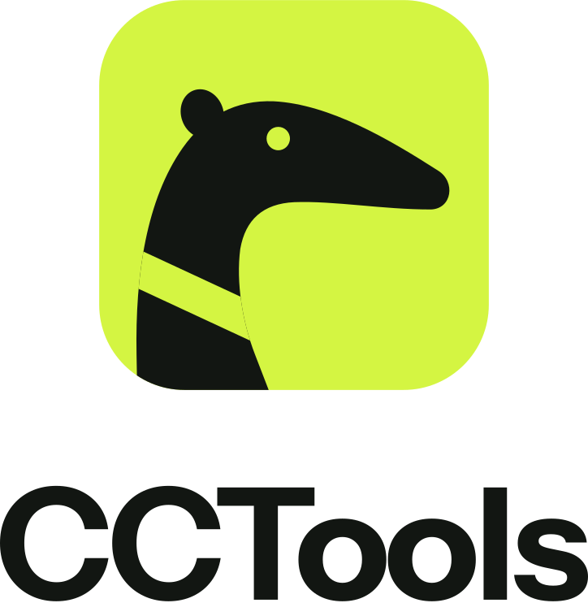
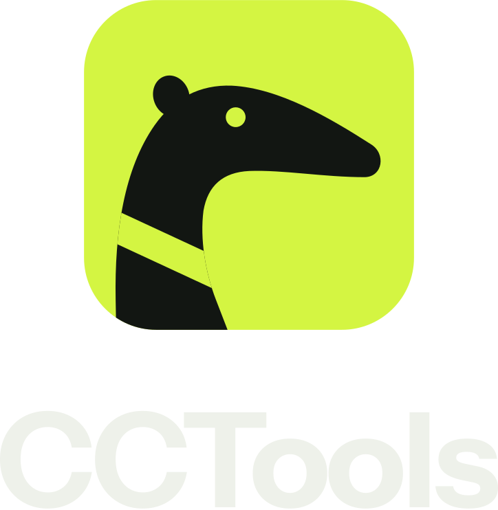

  <a className="cc-btn-plain is-primary" href="/brand/cctools-brand-kit.zip" download>Descargar el kit de marca</a>
  Logo, wordmark, icono y avatar, en SVG y PNG, en un solo ZIP.

## Nombre

- Escribe **CCTools**: una sola palabra, con la C, la C y la T en mayúscula. Nunca CC Tools, Cctools ni Canton Tools.
- X: [@cantontools](https://x.com/cantontools)
- Sitio web: [cctools.network](https://cctools.network)

Descripción en una línea:

> CCTools mantiene el registro público de Canton Network: un registro diario abierto que cualquiera puede descargar y citar, un directorio de los proyectos de la red, y herramientas para seguir sus mercados y su gobernanza.

En inglés:

> CCTools keeps the public record of the Canton Network: an open daily record anyone can download and cite, a directory of its projects, and tools to follow its markets and governance.

## Logo

El icono lime con el wordmark, en ink sobre fondos claros y en paper sobre fondos oscuros.

  

    

    
Fondos claros

    
<a href="/brand/cctools-logo-light.svg" download>SVG</a> <a href="/brand/cctools-logo-light.png" download>PNG</a>

  

  

    

    
Fondos oscuros

    
<a href="/brand/cctools-logo-dark.svg" download>SVG</a> <a href="/brand/cctools-logo-dark.png" download>PNG</a>

  

  

    

    
Apilado, fondos claros

    
<a href="/brand/cctools-logo-stacked-light.svg" download>SVG</a> <a href="/brand/cctools-logo-stacked-light.png" download>PNG</a>

  

  

    

    
Apilado, fondos oscuros

    
<a href="/brand/cctools-logo-stacked-dark.svg" download>SVG</a> <a href="/brand/cctools-logo-stacked-dark.png" download>PNG</a>

  

  

    

    
Un color, negro

    
<a href="/brand/cctools-logo-black.svg" download>SVG</a>

  

  

    

    
Un color, blanco

    
<a href="/brand/cctools-logo-white.svg" download>SVG</a>

  

  

    

    
Editorial, fondos claros

    
<a href="/brand/cctools-logo-editorial-light.svg" download>SVG</a>

  

  

    

    
Editorial, fondos oscuros

    
<a href="/brand/cctools-logo-editorial-dark.svg" download>SVG</a>

  

### Wordmark

  

    

    
Ink, fondos claros

    
<a href="/brand/cctools-wordmark-ink.svg" download>SVG</a> <a href="/brand/cctools-wordmark-ink.png" download>PNG</a>

  

  

    

    
Paper, fondos oscuros

    
<a href="/brand/cctools-wordmark-paper.svg" download>SVG</a> <a href="/brand/cctools-wordmark-paper.png" download>PNG</a>

  

  

    

    
Un color, negro

    
<a href="/brand/cctools-wordmark-black.svg" download>SVG</a>

  

  

    

    
Un color, blanco

    
<a href="/brand/cctools-wordmark-white.svg" download>SVG</a>

  

## Icono

Usa el icono por sí solo en avatares e iconos de app.

  

    

    
Lime, el icono principal

    
<a href="/brand/cctools-icon-lime.svg" download>SVG</a> <a href="/brand/cctools-icon-lime-512.png" download>PNG 512</a> <a href="/brand/cctools-icon-lime-1024.png" download>PNG 1024</a>

  

  

    

    
Ink, para lugares oscuros

    
<a href="/brand/cctools-icon-ink.svg" download>SVG</a> <a href="/brand/cctools-icon-ink-512.png" download>PNG 512</a>

  

  

    

    
Blanco, sobre color

    
<a href="/brand/cctools-icon-white.svg" download>SVG</a> <a href="/brand/cctools-icon-white-512.png" download>PNG 512</a>

  

  

    

    
Avatar para X, Telegram y Discord

    
<a href="/brand/cctools-avatar.svg" download>SVG</a> <a href="/brand/cctools-avatar-1024.png" download>PNG 1024</a> <a href="/brand/cctools-avatar-400.png" download>PNG 400</a>

  

## Mascota

Un oso hormiguero gigante: escarba en todo para encontrar lo que de verdad existe, como hace CCTools en Canton.

  <a className="cc-btn-plain" href="/brand/mascot/cctools-mascot.zip" download>Descargar la mascota</a>
  PNG transparente, 1254 px, en un solo ZIP.

  

    

    
Saludando

    
<a href="/brand/mascot/cctools-mascot-01-wave.png" download>PNG</a>

  

  

    

    
Leyendo

    
<a href="/brand/mascot/cctools-mascot-02-read.png" download>PNG</a>

  

  

    

    
De pie

    
<a href="/brand/mascot/cctools-mascot-03-standing.png" download>PNG</a>

  

  

    

    
Señalando

    
<a href="/brand/mascot/cctools-mascot-04-point.png" download>PNG</a>

  

  

    

    
Tarjeta en blanco

    
<a href="/brand/mascot/cctools-mascot-05-card.png" download>PNG</a>

  

  

    

    
Lupa

    
<a href="/brand/mascot/cctools-mascot-06-magnifier.png" download>PNG</a>

  

  

    

    
Brazos abiertos

    
<a href="/brand/mascot/cctools-mascot-07-arms-open.png" download>PNG</a>

  

  

    

    
Pensando

    
<a href="/brand/mascot/cctools-mascot-08-thinking.png" download>PNG</a>

  

- Usa las imágenes tal cual: sin voltearlas, redibujarlas, editarlas ni cambiar sus colores.
- No generes imágenes nuevas del personaje con IA.
- Nada de dinero, cohetes, lunas ni gráficos que se disparan.
- Nunca en material de la Canton Foundation ni de Digital Asset.
- Envíanos el arte antes de publicarlo.

## Colores

<ul className="cc-brand-swatches">
  <li>Ink <code>#121612</code></li>
  <li>Lime <code>#D4F542</code></li>
  <li>Paper <code>#EEF1EA</code></li>
  <li>Lime tint <code>#F1FAC8</code></li>
  <li>Page <code>#F4F5F1</code></li>
  <li>Ink 3 <code>#5F665D</code></li>
  <li>Dark page <code>#0B0E0B</code></li>
  <li>Dark surface <code>#141914</code></li>
</ul>

El lime es un relleno detrás de texto en ink, como un resaltador, y el color del fondo del icono. Nunca lo uses como texto, iconos o líneas finas sobre blanco, como fondo grande detrás de texto corrido, en botones de píldora o en una palabra en cursiva lime en un titular, ni en una C, un anillo, una moneda o cualquier cosa que parezca una marca de Canton.

## Tipografía

  

    
Aa

    
Instrument Sans

    
Para todo: 400 en el texto, 500 en etiquetas, 600 en títulos y cifras, 700 en el wordmark. Los titulares de los posts van en mayúsculas.

    
<a href="https://fonts.google.com/specimen/Instrument+Sans">Google Fonts</a>

  

  

    
&#123; &#125;

    
Fragment Mono

    
Solo para código, endpoints y atajos de teclado. Las cifras nunca usan mono.

    
<a href="https://fonts.google.com/specimen/Fragment+Mono">Google Fonts</a>

  

Ambas son gratuitas bajo la SIL Open Font License.

## Uso

  

<CardGroup cols={2}>
<Card title="Qué hacer">

- Deja un espacio libre de la mitad de la altura del icono alrededor del logo.
- Mantén el icono en 16 px o más. En 16 px, usa el <a href="/brand/cctools-icon-lime-16.svg" download>corte de 16 px</a>.
- Usa el avatar donde el icono se recorta en círculo: está dibujado para eso.
- Reserva el logo editorial para diseños grandes y tranquilos, como portadas e impresos.

</Card>
<Card title="Qué evitar">

- Cambiar el color de la cabeza, girarla o voltearla.
- Añadir efectos o contornos.
- Poner el icono sobre fotos recargadas.

</Card>
</CardGroup>

Canton is a registered trademark of Digital Asset (Switzerland) GmbH. Digital Asset is not affiliated with, and has not sponsored or endorsed, CCTools.
