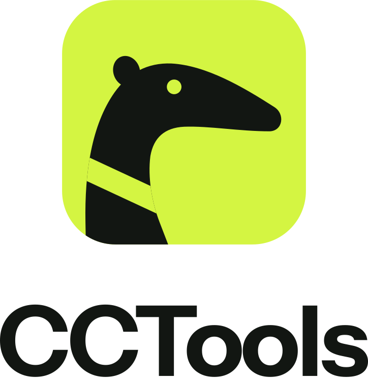
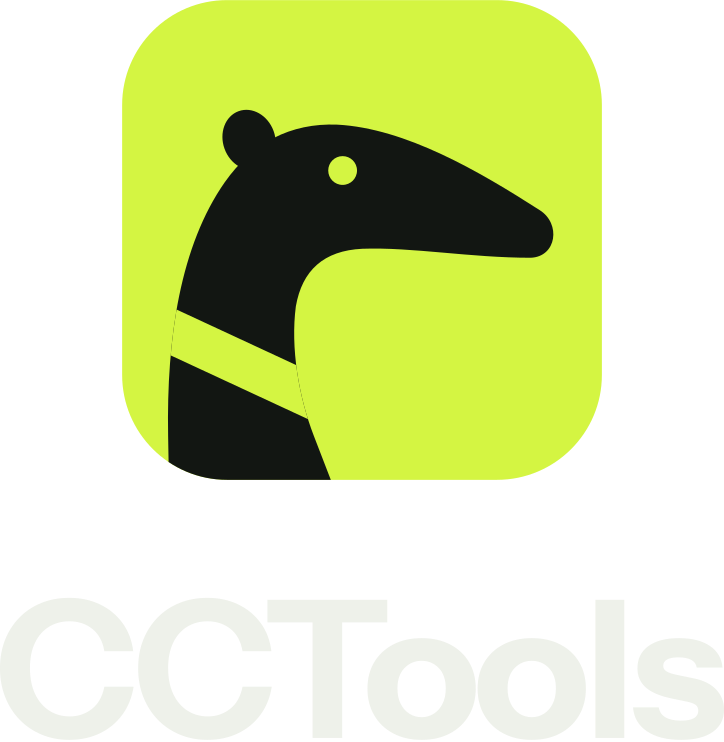

  <a className="cc-btn-plain is-primary" href="/brand/cctools-brand-kit.zip" download>Baixar o kit de marca</a>
  Todos os arquivos desta página, em SVG e PNG, num único ZIP.

## Nome

- Escreva **CCTools**: uma palavra só, com C, C e T maiúsculos. Nunca CC Tools, Cctools ou Canton Tools.
- X: [@cantontools](https://x.com/cantontools)
- Site: [cctools.network](https://cctools.network)

Descrição em uma linha:

> A CCTools mantém o registro público da Canton Network: um registro diário aberto que qualquer pessoa pode baixar e citar, um diretório dos projetos da rede, e ferramentas para acompanhar os mercados e a governança dela.

Em inglês:

> CCTools keeps the public record of the Canton Network: an open daily record anyone can download and cite, a directory of its projects, and tools to follow its markets and governance.

## Logo

O ícone lime com o wordmark, em ink nos fundos claros e em paper nos escuros.

  

    

    
Fundos claros

    
<a href="/brand/cctools-logo-light.svg" download>SVG</a> <a href="/brand/cctools-logo-light.png" download>PNG</a>

  

  

    

    
Fundos escuros

    
<a href="/brand/cctools-logo-dark.svg" download>SVG</a> <a href="/brand/cctools-logo-dark.png" download>PNG</a>

  

  

    

    
Empilhado, fundos claros

    
<a href="/brand/cctools-logo-stacked-light.svg" download>SVG</a> <a href="/brand/cctools-logo-stacked-light.png" download>PNG</a>

  

  

    

    
Empilhado, fundos escuros

    
<a href="/brand/cctools-logo-stacked-dark.svg" download>SVG</a> <a href="/brand/cctools-logo-stacked-dark.png" download>PNG</a>

  

  

    

    
Uma cor, preto

    
<a href="/brand/cctools-logo-black.svg" download>SVG</a>

  

  

    

    
Uma cor, branco

    
<a href="/brand/cctools-logo-white.svg" download>SVG</a>

  

  

    

    
Editorial, fundos claros

    
<a href="/brand/cctools-logo-editorial-light.svg" download>SVG</a>

  

  

    

    
Editorial, fundos escuros

    
<a href="/brand/cctools-logo-editorial-dark.svg" download>SVG</a>

  

### Wordmark

  

    

    
Ink, fundos claros

    
<a href="/brand/cctools-wordmark-ink.svg" download>SVG</a> <a href="/brand/cctools-wordmark-ink.png" download>PNG</a>

  

  

    

    
Paper, fundos escuros

    
<a href="/brand/cctools-wordmark-paper.svg" download>SVG</a> <a href="/brand/cctools-wordmark-paper.png" download>PNG</a>

  

  

    

    
Uma cor, preto

    
<a href="/brand/cctools-wordmark-black.svg" download>SVG</a>

  

  

    

    
Uma cor, branco

    
<a href="/brand/cctools-wordmark-white.svg" download>SVG</a>

  

## Ícone

Use o ícone sozinho em avatares e ícones de app.

  

    

    
Lime, o ícone principal

    
<a href="/brand/cctools-icon-lime.svg" download>SVG</a> <a href="/brand/cctools-icon-lime-512.png" download>PNG 512</a> <a href="/brand/cctools-icon-lime-1024.png" download>PNG 1024</a>

  

  

    

    
Ink, para lugares escuros

    
<a href="/brand/cctools-icon-ink.svg" download>SVG</a> <a href="/brand/cctools-icon-ink-512.png" download>PNG 512</a>

  

  

    

    
Branco, sobre cor

    
<a href="/brand/cctools-icon-white.svg" download>SVG</a> <a href="/brand/cctools-icon-white-512.png" download>PNG 512</a>

  

  

    

    
Avatar para X, Telegram e Discord

    
<a href="/brand/cctools-avatar.svg" download>SVG</a> <a href="/brand/cctools-avatar-1024.png" download>PNG 1024</a> <a href="/brand/cctools-avatar-400.png" download>PNG 400</a>

  

## Cores

<ul className="cc-brand-swatches">
  <li>Ink <code>#121612</code></li>
  <li>Lime <code>#D4F542</code></li>
  <li>Paper <code>#EEF1EA</code></li>
  <li>Lime tint <code>#F1FAC8</code></li>
  <li>Page <code>#F4F5F1</code></li>
  <li>Ink 3 <code>#5F665D</code></li>
  <li>Dark page <code>#0B0E0B</code></li>
  <li>Dark surface <code>#141914</code></li>
</ul>

O lime é um preenchimento atrás de texto em ink, como um marca-texto, e a cor do fundo do ícone. Nunca use o lime como texto, ícone ou linha fina sobre branco, como fundo grande atrás de texto corrido, em botões em pílula ou numa palavra em itálico lime num título, nem num C, num anel, numa moeda ou em qualquer coisa que pareça uma marca da Canton.

## Tipografia

  

    
Aa

    
Instrument Sans

    
Para tudo: 400 no texto, 500 nos rótulos, 600 em títulos e números, 700 no wordmark. Títulos de posts vão em maiúsculas.

    
<a href="https://fonts.google.com/specimen/Instrument+Sans">Google Fonts</a>

  

  

    
&#123; &#125;

    
Fragment Mono

    
Só para código, endpoints e atalhos de teclado. Números nunca usam mono.

    
<a href="https://fonts.google.com/specimen/Fragment+Mono">Google Fonts</a>

  

As duas são gratuitas sob a SIL Open Font License.

## Uso

  

<CardGroup cols={2}>
<Card title="O que fazer">

- Deixe uma área livre de metade da altura do ícone ao redor do logo.
- Mantenha o ícone com 16 px ou mais. Em 16 px, use o <a href="/brand/cctools-icon-lime-16.svg" download>corte de 16 px</a>.
- Use o avatar onde o ícone é recortado em círculo: ele foi desenhado para isso.
- Reserve o logo editorial para layouts grandes e calmos, como capas e impressos.

</Card>
<Card title="O que evitar">

- Mudar a cor da cabeça, girá-la ou espelhá-la.
- Adicionar efeitos ou contornos.
- Colocar o ícone sobre fotos carregadas.

</Card>
</CardGroup>

Canton is a registered trademark of Digital Asset (Switzerland) GmbH. Digital Asset is not affiliated with, and has not sponsored or endorsed, CCTools.
